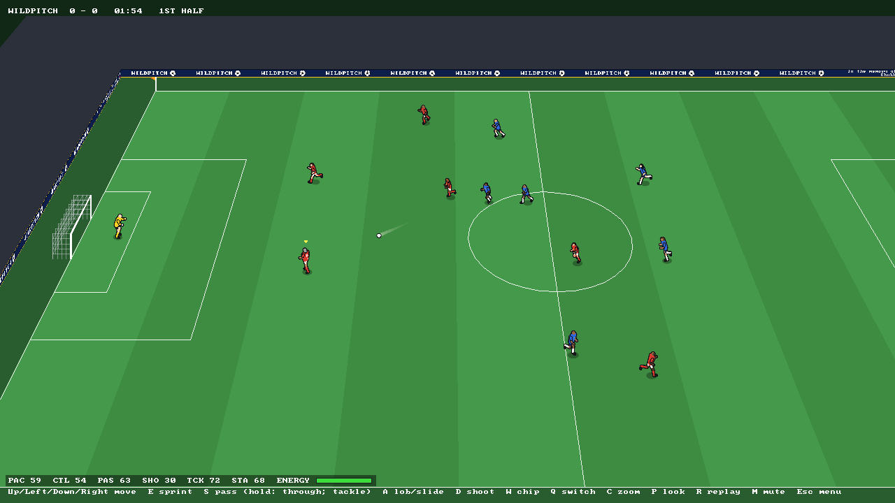

# WildPitch

*In the memory of my brother Shubham Thakkar ❤️*

A native C17 + SDL3 football game where players learn from drills you design, in a procedurally generated world.

**Status: early playable prototype.** Today it is a 7v7 (or 5v5) match against AI on a tilted 2.5D pitch. The
learning players and the generated world are the long-term vision, not built yet. It is built in small checkpoints
that the owner playtests: see [`docs/STATUS.md`](docs/STATUS.md) for where it is and
[`docs/ROADMAP.md`](docs/ROADMAP.md) for where it's going.



## What works now
- **Matches:** 7v7 (default) or 5v5 against AI teams that play as a unit, with difficulty levels, halves, a match
  clock with stoppage time and change of ends. Title screen with a quick-match setup (format, difficulty, half
  length, kits).
- **Ball physics:** a 3D ball with gravity, bounce, speed-dependent rolling friction, air drag and spin, all in
  deterministic fixed-point maths.
- **On the ball:** dribbling, sprinting, charged shots, chips, passes (hold for a through ball with a power meter),
  lofted passes with a power meter, sliding tackles.
- **Aerial play:** chest / thigh / foot control, headers (shots and header passes), volleys, half-volleys and
  lay-offs; press early and the action happens when the ball arrives.
- **Rules and set pieces:** throw-ins, corners, goal kicks, free kicks, penalties, fouls with advantage, offside, the
  back-pass rule; keepers dive, catch and distribute.
- **Presentation:** procedural animated players (three looks: Modern / Arcade / Retro), zoom levels, advertising
  boards and stands, goal celebrations and other visual effects, a 10-second instant replay with slow motion.
- **Audio:** every sound is synthesised at startup (no audio files): kicks, headers, whistles, net, crowd.
- **Input:** rebindable keyboard controls and gamepad support.
- **Runs cool:** fixed 60 Hz simulation, vsync-paced rendering, an optional 30 fps battery mode; menus redraw only
  on input.

## Build and run
You need CMake, Ninja, a C17 compiler (gcc or clang) and git. SDL3 is fetched (pinned) and built statically. On
Linux, install the audio development packages before the first build to get sound
(`sudo apt install libasound2-dev libpulse-dev` on Debian/Ubuntu).

```sh
tools/fetch_deps.sh                       # once: fetches pinned SDL3 into third_party/SDL
cmake -S . -B build -G Ninja && cmake --build build
./build/wildpitch                         # play 7v7 (--5v5 for the 5-a-side format)
```

Other useful flags:
```sh
./build/wildpitch --screenshot out.bmp    # renders --frames N (default 60), saves a BMP, exits
./build/wildpitch --demo                  # 8 scripted runners (animation check); --gallery = pose sheet
./build/wildpitch --style 0|1|2           # Modern / Arcade / Retro look; --zoom 0|1|2
./build/wildpitch --autoplay              # a scripted striker dribbles and shoots
./build/bench_sim                         # simulation speed (ticks/s)
```

## Controls
Keyboard defaults (rebind them in Esc -> Controls):

| Action | Key | Gamepad |
|---|---|---|
| Move | Arrow keys | Left stick / D-pad |
| Sprint | E | RB / RT |
| Pass (hold: through ball; near an opponent on the ball: tackle) | S | South (A / Cross) |
| Shoot (hold to charge) | D | East (B / Circle) |
| Lofted pass (hold for the meter) / sliding tackle | A | West (X / Square) |
| Chip shot | W | North (Y / Triangle) |
| Switch player | Q | LB |
| Zoom | C | R3 |
| Change look | P | L3 |
| Replay last 10 s | R | Back |
| Mute | M (when not bound to an action) | |
| Debug overlay | F3 | |
| Pause menu | Esc | Start |

The pause menu has Resume, Restart match, Main menu, Controls and Quit game, plus settings such as master / effects /
crowd volume, frame rate (60 or 30 battery), difficulty, movement assist and auto switching. Settings and key
bindings are saved between runs.

## Testing
```sh
ctest --test-dir build --output-on-failure   # all headless tests
tools/check_determinism.sh                   # gcc + clang x -O0 / -O2 must give the same golden hash
```
The simulation is bit-for-bit deterministic (fixed-point maths, no floats, seeded RNG), so a match is fully
reproducible from its inputs. That is what makes the instant replay, the regression tests, and the planned
learning and online features possible.

## Project layout
- `src/sim/` deterministic simulation: ball physics, players, AI, rules. No SDL, no floats, no allocation.
- `src/game/` presentation: window, rendering, avatars, HUD, menus, input, audio, replay. It only reads the sim.
- `tests/` headless tests, golden hashes and the `bench_sim` benchmark.
- `tools/` dependency fetch, determinism check, perf measurement and playtest helpers.
- `docs/` status, roadmap, design, architecture (code map) and the decision log.

## Roadmap
Phase 0, **Feel** (a 5-minute kickabout a stranger enjoys, on a laptop that stays cool), is in progress. Planned
after it: **Learn** (a drill editor and players who learn from the drills you run), **World** (a seeded world with
generated pitches, weather and careers), **Together** (local multiplayer and LAN play) and **Launch** (online play, more platforms). Details and the current
checkpoint: [`docs/ROADMAP.md`](docs/ROADMAP.md) and [`docs/STATUS.md`](docs/STATUS.md).
